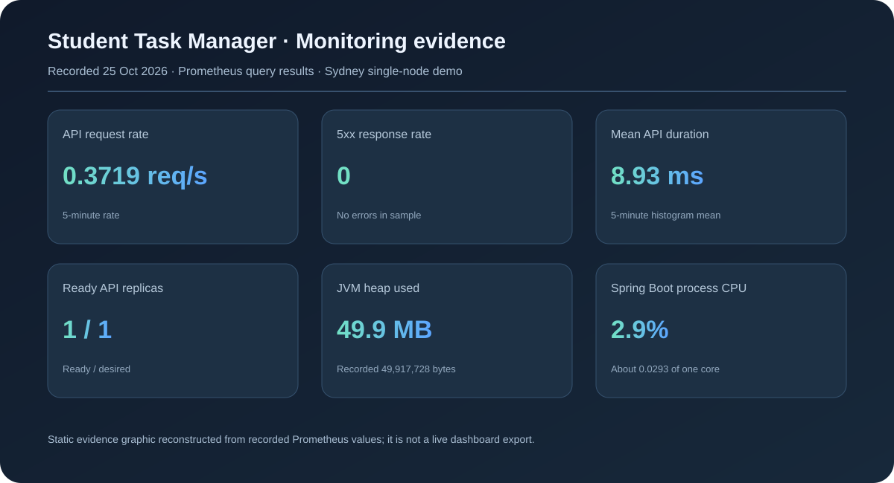

# Auto-Scaling and Self-Healing Cloud-Native Student Task Manager

**Team:** Myisha Siddiqui (240905560), Manan Bhasin (240905492), Rishabh Raj (240905420)

## Abstract

This project packages a Spring Boot task-management API and browser dashboard with Docker, provisions a small AWS environment with Terraform, and runs the API on Kubernetes (K3s) on an EC2 host. A Horizontal Pod Autoscaler (HPA) adjusts API pod replicas in response to CPU demand. A live load run demonstrated scaling from one to two pods and back to one; deleting an API pod demonstrated Kubernetes replacement after the ECR pull credential was refreshed. Prometheus and kube-state-metrics feed a six-panel Grafana operations dashboard, which is reachable for the live demo through a private Systems Manager (SSM) port-forward.

## Objective and architecture

The objective is to demonstrate container deployment, infrastructure automation, pod autoscaling, and pod recovery. The deployed path is:

```text
Browser → Kubernetes NodePort Service → Spring Boot API pod(s) → private RDS MySQL
                         K3s on one EC2 host
Terraform provisions the VPC, EC2, RDS, ECR, IAM, and network rules
Docker builds the API image; ECR stores the image
Systems Manager provides a secure shell and local port-forward without public SSH
```

The implemented application is a Student Task Manager with create, list, read, edit, complete, and delete operations. The planning synopsis described a student-records API; the implementation adapted the application domain and added a dashboard while retaining the cloud-native scaling and recovery objective.

## Implementation

- Spring Boot exposes `/api/tasks` and health endpoints. MySQL stores task data.
- Docker packages the application. Amazon ECR stores the image used by K3s.
- Terraform defines one EC2 host running K3s, private RDS MySQL, ECR, networking, and scoped access.
- Kubernetes runs one baseline API replica with startup, liveness, and readiness probes. The HPA targets 60% CPU and allows one to two replicas.
- Prometheus scrapes Spring Boot Actuator and kube-state-metrics. Grafana provides a private six-panel dashboard for API traffic/errors/latency, replica health, JVM heap, and process CPU. For the live demo, open `http://localhost:3000/d/student-task-manager-ops/student-task-manager-operations` while the SSM tunnel in `DEMO_RUNBOOK.md` is running; Grafana remains ClusterIP-only.
- GitHub Actions tests and packages the application and validates Terraform. A separate manual release workflow is prepared in `.github/workflows/manual-aws-release.yml`; it is not push-triggered and is currently blocked because an AWS Organizations SCP denied creation and inspection of the GitHub OIDC provider. The OIDC role and GitHub environment variables remain unconfigured.

## Verification and results

The detailed evidence and deployed UI screenshots are in [`evidence/DEMO_EVIDENCE.md`](evidence/DEMO_EVIDENCE.md). The reproducible sequence is in [`DEMO_RUNBOOK.md`](DEMO_RUNBOOK.md).

| Check | Result |
|---|---|
| Deployed readiness and UI | Readiness `UP`; UI HTTP 200 through SSM port-forward |
| Task persistence | A saved task appeared in the deployed UI and API response after page load |
| k6 load run | 30 maximum virtual users; 5,699 GET requests; 0% failures; p95 403.98 ms |
| HPA scale-up | CPU exceeded the 60% target; replicas increased from 1 to 2; both pods became Ready |
| HPA scale-down | After load stopped and the stabilization period elapsed, replicas returned to 1 |
| Pod replacement | Deleting a pod caused the Deployment to create a replacement that reached `1/1 Running` |
| Liveness recovery | A controlled Java-process pause triggered the liveness probe; Kubernetes restarted the container and the readiness endpoint returned `UP` |
| Monitoring verification | Prometheus API, kube-state-metrics, and application targets all reported `up`; Grafana datasource health was `OK`; the six-panel dashboard loaded |
| Live Grafana access | SSM private port-forward reached Grafana on local port 3000; health returned `database: ok`, version `12.4.13`; dashboard API returned six panels |
| CI validation | Application test/package/container build and Terraform format/validation jobs passed in [GitHub Actions run 33](https://github.com/myishaa/student-task-manager/actions/runs/40094738509) |

The HPA observed CPU as high as 319% of the pod CPU request during the load run. Its replica maximum was two, so it could not add more capacity than the single-node demo permits.

## Limitations and remaining work

- The cluster has one EC2 node. Pod recovery does not protect against EC2 host failure.
- The HPA is configured for one to two pods, below the original plan's two-to-four range, to fit the low-cost demo host.
- The self-healing exercise first encountered `ImagePullBackOff` because the ECR pull secret had expired. Refreshing the secret allowed the replacement to start. ECR tokens expire after 12 hours, so this demo currently needs periodic secret refresh.
- Prometheus keeps six hours of metrics in temporary pod storage; a Prometheus pod recreation loses its history. Grafana's database is temporary and its dashboard is recreated from the Kubernetes manifests.
- GitHub Actions CI validates and packages the app. The manual AWS release workflow is not active: AWS Organizations SCP `p-dz3d6hmi` explicitly denied `iam:CreateOpenIDConnectProvider` and `iam:GetOpenIDConnectProvider`, and the intended `student-task-manager-github-actions` role is absent. An Organizations administrator must allow or create the provider and role; the GitHub `aws-demo` environment and repository variables must also be configured. No image publish or release deployment has been triggered.
- Pod autoscaling changes pod capacity, not the fixed EC2 or RDS size. No AWS billing savings are claimed from this test.

## Cost analysis

The modeled on-demand estimate for the current Sydney configuration is about **$47.31/month** before taxes, credits, and variable charges, assuming 730 hours and 1 GB of retained ECR images. This is not the account's actual bill. Cost Explorer was not queried, so actual usage, remaining credits, and free-plan eligibility have not been verified.

| Cost component | Estimate per month |
|---|---:|
| EC2 t3.small | $19.27 |
| EC2 gp3 root volume, 30 GB | $2.88 |
| Public IPv4 address | $3.65 |
| RDS MySQL db.t4g.micro | $18.25 |
| RDS gp3 storage, 20 GB | $2.76 |
| Secrets Manager, one secret | $0.40 |
| ECR, assuming 1 GB retained | $0.10 |
| **Estimated total** | **$47.31** |

The HPA changes pod count on the same EC2 and RDS instances, so pod scale-down changes the provisioned infrastructure estimate by approximately $0. A separately labeled future worker-node scenario is in [COST_ANALYSIS.md](COST_ANALYSIS.md), together with assumptions, calculations, and pricing references.

The static monitoring summary below is reconstructed from recorded Prometheus query values. It is not a Grafana screenshot. The live six-panel dashboard is separately available at the local URL above while the private SSM port-forward is active.



## Conclusion

The deployed prototype demonstrates a browser-backed task application, containerized delivery, Terraform-defined AWS infrastructure, Kubernetes pod-level recovery, CPU-based pod scaling, and live private monitoring. The live test observed both HPA scale-up and scale-down with no failed GET requests at the tested load. The results apply to this single-node demo and do not establish multi-node or host-level high availability. The automated AWS release path remains prepared but inactive until an AWS Organizations administrator resolves the OIDC policy restriction and the GitHub environment is configured.
