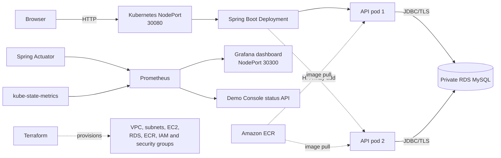

# Auto-Scaling and Self-Healing Cloud-Native Student Task Manager

**StudySpace** is a full-stack student task manager built to demonstrate how a containerized application can be deployed, monitored, automatically scaled, and automatically recovered in AWS.

The browser interface and REST API are served by Spring Boot. Tasks are stored in MySQL. Docker packages the application, Terraform creates the AWS infrastructure, K3s provides Kubernetes on EC2, the Horizontal Pod Autoscaler changes the number of API pods, and Prometheus plus Grafana expose the system's health and performance.


## Team

| Name | Registration number |
|---|---:|
| Myisha Siddiqui | 240905560 |
| Manan Bhasin | 240905492 |
| Rishabh Raj | 240905420 |

## Project at a glance

| Area | Implementation |
|---|---|
| Application | Student task dashboard and REST API |
| Backend | Java 21, Spring Boot 3.5, Spring Data JPA |
| Database | MySQL locally; private Amazon RDS MySQL on AWS |
| Containerization | Multi-stage Docker build and non-root runtime |
| Infrastructure as code | Terraform 1.6+ with the AWS provider |
| Container platform | Single-node K3s cluster on Amazon EC2 |
| Image registry | Amazon ECR |
| Autoscaling | Kubernetes HPA, 1–2 replicas, 60% CPU target |
| Self-healing | Deployment reconciliation and liveness-probe restarts |
| Monitoring | Prometheus, kube-state-metrics, Grafana and Spring Actuator |
| Continuous integration | GitHub Actions tests, packages and validates Terraform |
| AWS region | Asia Pacific (Sydney), `ap-southeast-2` |

> This is a demonstration environment, not a production system. It uses one EC2 node, a Single-AZ database, temporary monitoring storage, plain HTTP, and no user authentication. Public demo access must be closed after the presentation.

## Contents

1. [Purpose](#purpose)
2. [What the application does](#what-the-application-does)
3. [Architecture](#architecture)
4. [End-to-end request flow](#end-to-end-request-flow)
5. [Technology responsibilities](#technology-responsibilities)
6. [Repository structure](#repository-structure)
7. [Task model and REST API](#task-model-and-rest-api)
8. [Run locally with Docker](#run-locally-with-docker)
9. [Run locally without Docker](#run-locally-without-docker)
10. [AWS infrastructure](#aws-infrastructure)
11. [Kubernetes deployment](#kubernetes-deployment)
12. [Autoscaling](#autoscaling)
13. [Self-healing](#self-healing)
14. [Monitoring and Demo Console](#monitoring-and-demo-console)
15. [Testing and verified results](#testing-and-verified-results)
16. [CI/CD](#cicd)
17. [Live demonstration sequence](#live-demonstration-sequence)
18. [Security and cost](#security-and-cost)
19. [Limitations](#limitations)
20. [Troubleshooting](#troubleshooting)
21. [Cleanup](#cleanup)
22. [Reports and evidence](#reports-and-evidence)

## Purpose

The project has two connected goals:

1. Build a usable application in which students can organize academic tasks.
2. Use that application to demonstrate cloud-native behaviour: container delivery, infrastructure automation, pod autoscaling, self-healing, health checks, persistent data, and live monitoring.

The important idea is separation of responsibilities. The application pods are disposable and stateless, while task data is stored separately in MySQL. Kubernetes can therefore replace or scale API pods without deleting saved tasks.

## What the application does

The StudySpace dashboard allows a user to:

- Create a task with a title, description, due date and priority.
- Move a task between `TODO`, `IN_PROGRESS` and `DONE`.
- Edit or delete a task.
- Filter the task list by status.
- Refresh the page and retrieve the same data from MySQL.
- View whether the browser can communicate with the API.

Spring Boot serves both the browser files and the REST API. This same-origin design avoids a separate frontend server and does not require cross-origin configuration.

## Architecture



### AWS layout

- A VPC uses CIDR `10.42.0.0/16`.
- One public subnet contains the EC2 K3s host.
- Two private subnets contain the RDS subnet group.
- K3s uses pod CIDR `10.244.0.0/16`, avoiding overlap with the VPC.
- RDS is not publicly accessible and accepts MySQL traffic only from the application security group.
- The EC2 instance has no inbound SSH rule; AWS Systems Manager provides administration access.
- ECR stores the Docker image used by the Kubernetes Deployment.
- AWS Secrets Manager stores the RDS-generated master password.

## End-to-end request flow

When a user creates a task:

1. The browser sends `POST /api/tasks` with JSON data.
2. The EC2 NodePort forwards the request to the Kubernetes Service.
3. The Service selects a Ready Spring Boot pod.
4. `TaskController` validates the request and calls `TaskService`.
5. `TaskService` normalizes the data and uses `TaskRepository`.
6. Spring Data JPA writes the row to the MySQL `tasks` table.
7. The API returns HTTP `201 Created` and the saved task as JSON.
8. The browser updates the task list.
9. A later refresh sends `GET /api/tasks`, proving that the data is stored in MySQL rather than only in browser memory.

The same request can be served by either API pod because the pods do not keep task state locally.

## Technology responsibilities

| Technology | Role in this project |
|---|---|
| HTML, CSS and JavaScript | Responsive StudySpace dashboard and Demo Console |
| Java 21 and Spring Boot | REST API, validation, business logic and static-file serving |
| Spring Data JPA | Database access and entity mapping |
| MySQL | Persistent task storage |
| Docker | Reproducible build and runtime image |
| Amazon ECR | Private container image registry |
| Terraform | Repeatable AWS infrastructure definition |
| Amazon EC2 | Host for the single-node K3s cluster |
| K3s/Kubernetes | Deployment, Service, probes, scheduling, HPA and recovery |
| Amazon RDS | Managed private MySQL database |
| Systems Manager | Shell access without opening SSH |
| Prometheus | Scrapes and queries application/Kubernetes metrics |
| kube-state-metrics | Exposes Kubernetes object state to Prometheus |
| Grafana | Six-panel operational dashboard |
| k6 | Bounded functional and autoscaling load tests |
| GitHub Actions | Application verification and Terraform validation |

## Repository structure

```text
.
├── src/main/java/                   Spring Boot application
│   └── com/ccd/studenttaskmanager/
│       ├── task/                    Task entity, API, service and repository
│       └── demo/                    Demo Console monitoring endpoint
├── src/main/resources/
│   ├── application.yml              Application and Actuator configuration
│   └── static/
│       ├── index.html               StudySpace browser interface
│       └── demo.html                One-page presentation console
├── src/test/                        JUnit and Mockito tests
├── Dockerfile                       Multi-stage application image
├── compose.yaml                     Local API and MySQL environment
├── infra/                           Terraform AWS infrastructure
├── k8s/                             Application Kubernetes manifests
│   └── monitoring/                  Prometheus, Grafana and kube-state-metrics
├── load-tests/                      k6 functional and autoscaling tests
├── evidence/                        Screenshots and verified demo evidence
├── .github/workflows/               CI and manual AWS release workflows
├── FINAL_REPORT.md                  Full implementation report
├── COST_ANALYSIS.md                 AWS estimate and assumptions
└── Student_Task_Manager_Project_Presentation.pptx
```

## Task model and REST API

### Task fields

| Field | Rules |
|---|---|
| `id` | Database-generated numeric ID |
| `title` | Required, non-blank, maximum 160 characters |
| `description` | Optional, maximum 2,000 characters |
| `dueDate` | Optional ISO date such as `2026-10-30` |
| `priority` | Required: `LOW`, `MEDIUM` or `HIGH` |
| `status` | `TODO`, `IN_PROGRESS` or `DONE`; defaults to `TODO` |
| `createdAt` | UTC creation timestamp |
| `updatedAt` | UTC last-update timestamp |

The database entity also uses optimistic locking internally through a version column.

### API endpoints

| Method | Path | Expected result |
|---|---|---|
| `POST` | `/api/tasks` | Create a task; HTTP 201 |
| `GET` | `/api/tasks` | List all tasks; optionally use `?status=DONE` |
| `GET` | `/api/tasks/{id}` | Retrieve one task; HTTP 404 if absent |
| `PUT` | `/api/tasks/{id}` | Replace editable fields |
| `PATCH` | `/api/tasks/{id}/status` | Change only the task status |
| `DELETE` | `/api/tasks/{id}` | Delete a task; HTTP 204 |
| `GET` | `/actuator/health` | Overall application health |
| `GET` | `/actuator/health/liveness` | Kubernetes liveness probe |
| `GET` | `/actuator/health/readiness` | Kubernetes readiness probe |
| `GET` | `/actuator/prometheus` | Prometheus-format application metrics |
| `GET` | `/api/demo/status` | Read-only live presentation metrics |

Example task creation:

```sh
curl -X POST http://localhost:8080/api/tasks \
  -H 'Content-Type: application/json' \
  -d '{
    "title":"Review cloud computing notes",
    "description":"Prepare for Friday",
    "dueDate":"2026-10-30",
    "priority":"HIGH"
  }'
```

## Run locally with Docker

### Requirements

- Docker Desktop with Docker Compose.
- Port `8080` available.

### Start the project

```sh
docker compose up --build
```

Open:

- StudySpace: <http://localhost:8080>
- Demo Console: <http://localhost:8080/demo.html>
- REST API: <http://localhost:8080/api/tasks>
- Health: <http://localhost:8080/actuator/health>

The Demo Console works locally, but cluster-only Prometheus values are marked unavailable because local Compose does not run the Kubernetes monitoring stack.

### Stop the project

```sh
docker compose down
```

The named `mysql_data` volume preserves tasks between restarts. To deliberately remove local database data:

```sh
docker compose down -v
```

### Local passwords

The defaults in `compose.yaml` are development-only. Override them without committing a `.env` file:

```sh
DB_PASSWORD='choose-a-local-password' \
MYSQL_ROOT_PASSWORD='choose-a-different-local-password' \
docker compose up --build
```

Never reuse these values in AWS or commit real credentials.

## Run locally without Docker

Requirements:

- Java 21
- Maven 3.6.3 or later
- A reachable MySQL database

Set the database variables and start Spring Boot:

```sh
export DB_URL='jdbc:mysql://localhost:3306/student_task_manager?useSSL=false&serverTimezone=UTC'
export DB_USERNAME='task_manager'
export DB_PASSWORD='your-local-password'
mvn spring-boot:run
```

Application configuration is controlled by these environment variables:

| Variable | Purpose | Default |
|---|---|---|
| `PORT` | HTTP server port | `8080` |
| `DB_URL` | JDBC connection URL | Local MySQL URL |
| `DB_USERNAME` | Database username | `task_manager` |
| `DB_PASSWORD` | Database password | Development-only default |
| `DEMO_PROMETHEUS_URL` | Prometheus base URL used by `/api/demo/status` | Cluster DNS URL |

## Container image

The `Dockerfile` uses two stages:

1. Maven and Java 21 download dependencies and package the JAR.
2. A smaller Java 21 runtime copies only the packaged JAR.

The final container:

- Runs as non-root user ID `10001`.
- Exposes port `8080`.
- Limits Java heap sizing with `-XX:MaxRAMPercentage=75`.
- Contains no Maven toolchain or source files.

Build it manually with:

```sh
docker build --platform linux/amd64 -t student-task-manager:local .
```

The `linux/amd64` flag is important when the image is built on an Apple Silicon Mac for the current x86_64 EC2 host.

## AWS infrastructure

Terraform in [`infra/`](infra/) defines:

- VPC, Internet Gateway and route table.
- One public EC2 subnet.
- Two private database subnets in separate Availability Zones.
- One `t3.small` EC2 instance with a 30 GB encrypted gp3 volume.
- K3s installation through EC2 user data.
- One private `db.t4g.micro` RDS MySQL instance with 20 GB encrypted gp3 storage.
- An ECR repository with scan-on-push.
- IAM instance role for Systems Manager, ECR read access and RDS secret retrieval.
- Application and database security groups.
- RDS master credentials managed by Secrets Manager.

### Safe Terraform workflow

Verify the intended AWS account before planning anything:

```sh
AWS_PROFILE=default AWS_REGION=ap-southeast-2 \
aws sts get-caller-identity
```

Initialize and validate:

```sh
terraform -chdir=infra init
terraform -chdir=infra fmt -check -recursive
terraform -chdir=infra validate
```

Create a reviewed plan. Prefer the presenter's current public IP with `/32`; an empty set leaves the application NodePort closed:

```sh
AWS_PROFILE=default AWS_REGION=ap-southeast-2 \
terraform -chdir=infra plan \
  -var='aws_region=ap-southeast-2' \
  -var='demo_allowed_cidrs=["YOUR_PUBLIC_IP/32"]'
```

`terraform apply` creates billable AWS resources. Run it only after reviewing the plan, verifying the AWS account and region, and explicitly approving the cost and changes. See [`infra/README.md`](infra/README.md) for the full provisioning procedure.

Useful outputs:

```sh
terraform -chdir=infra output -raw api_url
terraform -chdir=infra output -raw ec2_instance_id
terraform -chdir=infra output -raw ecr_repository_url
terraform -chdir=infra output -raw rds_endpoint
```

## Kubernetes deployment

The application manifests are in [`k8s/`](k8s/):

| Manifest | Responsibility |
|---|---|
| `namespace.yaml` | Creates `student-task-manager` |
| `deployment.yaml` | Runs the Spring Boot API pods |
| `service.yaml` | Exposes the API through NodePort `30080` |
| `hpa.yaml` | Scales the Deployment between 1 and 2 pods |

Before applying the Deployment:

1. Build and push a versioned `linux/amd64` image to ECR.
2. Create `task-manager-config` with the private RDS JDBC URL and username.
3. Create `task-manager-db` from the RDS password without storing it in Git.
4. Create the short-lived `ecr-pull` registry secret.
5. Substitute the exact ECR image URI for the placeholder in `deployment.yaml`.
6. Apply the namespace, Deployment, Service and HPA.

Follow [`k8s/README.md`](k8s/README.md) for the safe commands and secret-handling procedure.

### Pod configuration

The API container is configured with:

- CPU request `100m`; limit `500m`.
- Memory request `256Mi`; limit `512Mi`.
- Startup, liveness and readiness HTTP probes.
- Non-root user and group `10001`.
- Runtime-default seccomp profile.
- No Linux capabilities and no privilege escalation.
- Read-only root filesystem with a temporary `/tmp` volume.
- Rolling updates with zero planned unavailable pods.

## Autoscaling

The Horizontal Pod Autoscaler watches CPU utilization relative to the pod's CPU request:

```text
Target CPU:       60%
Minimum replicas: 1
Maximum replicas: 2
Scale-down wait:  180 seconds
```

The lifecycle is:

```text
Normal load       High load          More capacity       Load ends
1 Ready pod  →  CPU above 60%  →  2 Ready pods  →  back to 1 pod
```

Run the read-only autoscaling workload only against an environment you own:

```sh
BASE_URL='http://YOUR_EC2_IP:30080' \
MAX_VUS=30 \
k6 run load-tests/autoscaling.js
```

The browser Demo Console also contains a bounded read-only load generator. It calls `GET /api/tasks`; it does not create or delete task data.

Important: this HPA scales pods on the same EC2 host. It does not add EC2 instances and does not reduce the fixed EC2 or RDS hourly cost when it scales down.

## Self-healing

Kubernetes continuously compares the desired state with the actual state.

### Deployment reconciliation

If the API pod is deleted, the Deployment notices that its replica count is below the desired value and creates a replacement:

```sh
POD=$(sudo k3s kubectl get pods \
  -n student-task-manager \
  -l app.kubernetes.io/name=task-manager-api \
  -o jsonpath='{.items[0].metadata.name}')

sudo k3s kubectl delete pod "$POD" -n student-task-manager
sudo k3s kubectl get pods -n student-task-manager --watch
```

Run these commands inside the EC2 Systems Manager session, not in the Mac terminal. A replacement should progress to `1/1 Running`.

### Liveness recovery

Kubernetes calls `/actuator/health/liveness` every 10 seconds after startup. Three consecutive failures cause the container to restart. The readiness probe prevents traffic from being sent until `/actuator/health/readiness` succeeds again.

The recorded controlled test produced this sequence:

```text
Liveness probe failed → container restarted → readiness returned UP
```

This proves pod/container recovery, not EC2 host failover. The single EC2 node remains a failure point.

## Monitoring and Demo Console

### Prometheus

Prometheus scrapes every 15 seconds:

- Spring Boot `/actuator/prometheus` metrics.
- kube-state-metrics for Deployments, pods and HPAs.
- Prometheus itself.

It retains up to six hours or 256 MB in an `emptyDir` volume. History is lost if the Prometheus pod is recreated.

### Grafana

Grafana 12.4.13 is provisioned from Kubernetes manifests and exposes six panels:

1. API request rate.
2. HTTP 5xx error rate.
3. Average API response duration.
4. Ready and desired API replicas.
5. JVM heap usage.
6. Spring Boot process CPU.

Grafana is configured for anonymous Viewer access in this demo and uses NodePort `30300`. Do not expose that port broadly except for the short presentation window. A safer option is an SSM port-forward.

### Demo Console

`/demo.html` provides a presentation-friendly page showing:

- The application in the browser.
- The Browser → K3s → Spring Boot → RDS architecture.
- Readiness and database-connected API health.
- Live Deployment, pod, Service and HPA information derived from Prometheus.
- Request rate, errors, latency, CPU, memory and replica metrics.
- A bounded read-only load generator.
- Recorded autoscaling and self-healing evidence.
- A link to the full Grafana dashboard.

The browser does not connect directly to the private Prometheus Service. It calls `/api/demo/status`; Spring Boot queries Prometheus through cluster DNS and returns a limited read-only snapshot.

## Testing and verified results

### Automated checks

Run unit tests and package the application:

```sh
mvn verify
```

The service tests verify:

- Task creation trims text and defaults the status to `TODO`.
- A task status update changes and saves the existing entity.
- Looking up a missing task produces HTTP 404 behaviour.

Build the container as an additional check:

```sh
docker build --tag student-task-manager:test .
```

### Functional k6 test

`load-tests/tasks.js` creates a temporary task, reads it, marks it complete and deletes it:

```sh
BASE_URL=http://localhost:8080 MAX_VUS=5 k6 run load-tests/tasks.js
```

Its thresholds require fewer than 1% failed requests and p95 latency below 500 ms.

### Recorded AWS results

| Measurement | Verified result |
|---|---:|
| Maximum virtual users | 30 |
| HTTP requests | 5,699 |
| Request rate | 43.7 requests/second |
| Failed requests | 0 / 0.00% |
| p95 response time | 403.98 ms |
| HPA CPU target | 60% |
| Observed CPU peak | 319% of the requested CPU |
| Replica transition | 1 → 2 → 1 |
| Replacement pod | Reached `1/1 Running` |
| Final readiness | `UP` |

See [`evidence/DEMO_EVIDENCE.md`](evidence/DEMO_EVIDENCE.md) for the complete record and scope.

## CI/CD

### Continuous integration

`.github/workflows/ci.yml` runs for relevant pushes and pull requests. It:

1. Sets up Java 21.
2. Runs `mvn verify`.
3. Builds the Docker image.
4. Checks Terraform formatting.
5. Initializes Terraform without a backend.
6. Runs `terraform validate`.

### Manual AWS release

`.github/workflows/manual-aws-release.yml` is intentionally manual. When its OIDC role and repository variables are configured, it can:

1. Verify that the workflow authenticated to the intended AWS account.
2. Build an immutable commit-tagged image.
3. Push the image to ECR.
4. Use Systems Manager Run Command to refresh the ECR pull secret.
5. Update the K3s Deployment and wait for rollout completion.

The workflow never runs on an ordinary push. It requires the operator to select `DEPLOY` and depends on an externally configured GitHub OIDC role and repository variables.

## Live demonstration sequence

### 1. Show the application and persistence

1. Open `http://YOUR_EC2_IP:30080/`.
2. Click **Add a task**.
3. Create a task with a title and priority.
4. Mark it complete.
5. Refresh the page.
6. Explain: the browser called the Spring Boot API, and the API saved the task in RDS MySQL, so the task remains after refresh.

### 2. Explain the architecture

Open `http://YOUR_EC2_IP:30080/demo.html` and explain:

```text
Browser → Kubernetes Service → Spring Boot pod(s) → private RDS MySQL
```

Then identify Docker/ECR as the image path, Terraform as the infrastructure definition, and Prometheus/Grafana as the monitoring path.

### 3. Show live health and Kubernetes state

In the Demo Console, point out:

- Readiness is `UP`.
- The Deployment has its desired Ready replica count.
- The pod status is Running and Ready.
- HPA minimum, maximum, target and current replica count.

### 4. Demonstrate autoscaling

1. Start the bounded read-only load generator.
2. Watch CPU and HPA desired replicas.
3. Explain that HPA adds a second pod when CPU remains above 60%.
4. Confirm both pods become Ready.
5. Stop the workload and explain the 180-second stabilization window before scale-down.

### 5. Explain self-healing

Use the recorded evidence in the Demo Console, or perform the controlled pod-deletion command from an SSM session. Explain that the Deployment controller restored the missing replica and that the liveness test independently caused Kubernetes to restart an unhealthy container.

### 6. Show Grafana

Open:

```text
http://YOUR_EC2_IP:30300/d/student-task-manager-ops/student-task-manager-operations
```

Connect the panels to the behaviour just shown: load raises request rate and CPU, HPA changes desired replicas, and ready-replica metrics confirm availability.

### 7. Conclude

Summarize the proof:

- Docker packaged the application.
- Terraform created the AWS environment.
- Kubernetes ran, scaled and recovered the API.
- RDS preserved task data independently of pods.
- Prometheus and Grafana made the behaviour observable.

The ready-to-present slide deck is [`Student_Task_Manager_Project_Presentation.pptx`](Student_Task_Manager_Project_Presentation.pptx). Every slide contains speaker notes.

## Security and cost

### Security controls implemented

- RDS is private and not assigned a public address.
- Port 3306 accepts traffic only from the application security group.
- EC2 administration uses Systems Manager rather than inbound SSH.
- The EC2 metadata endpoint requires IMDSv2.
- RDS storage and the EC2 root volume are encrypted.
- RDS credentials are generated and stored by Secrets Manager.
- The container runs as non-root with reduced Linux privileges.
- Kubernetes credentials are stored in Secrets, not committed manifests.
- ECR image scanning is enabled.

### Demo security limitations

- The application has no login, authorization or per-student ownership.
- Public NodePort traffic uses HTTP, not HTTPS.
- Anyone who can reach port `30080` can view and modify tasks.
- Anonymous Grafana viewers can see monitoring data if port `30300` is public.
- Public rules such as `0.0.0.0/0` are acceptable only for a short supervised demo and must be removed afterward.

### Cost estimate

The modeled Sydney on-demand estimate is approximately **USD 47.31 per month** before taxes, credits and variable usage. This is a model, not the actual AWS bill.

| Component | Modeled monthly cost |
|---|---:|
| EC2 `t3.small` | $19.27 |
| EC2 gp3, 30 GB | $2.88 |
| Public IPv4 | $3.65 |
| RDS `db.t4g.micro` | $18.25 |
| RDS gp3, 20 GB | $2.76 |
| Secrets Manager | $0.40 |
| Assumed ECR storage | $0.10 |
| **Total** | **$47.31** |

Credits may offset eligible charges but do not make running resources free. See [`COST_ANALYSIS.md`](COST_ANALYSIS.md) and confirm current regional pricing before relying on the estimate.

## Limitations

- One EC2 node means there is no host-level high availability.
- HPA is capped at two pods to fit the small demo host.
- RDS is Single-AZ in this cost-conscious configuration.
- HPA changes pod capacity, not EC2 or RDS capacity.
- Hibernate `ddl-auto=update` is convenient for the prototype; production should use versioned migrations such as Flyway or Liquibase.
- There is no authentication, authorization or tenant isolation.
- Prometheus and Grafana use temporary `emptyDir` storage.
- ECR login tokens expire after 12 hours, so the pull secret must be refreshed before a later rollout.
- Public access uses an IP address and NodePorts instead of DNS, HTTPS and a load balancer.
- Recorded performance applies only to the tested workload and environment.

## Troubleshooting

### `k3s: command not found` on the Mac

`k3s` is installed on the EC2 instance, not on the laptop. Start an AWS Systems Manager session first, then run `sudo k3s kubectl ...` at the remote `sh-5.2$` prompt.

### Replacement pod shows `ImagePullBackOff`

The ECR authorization token in `ecr-pull` probably expired. Refresh the pull secret using the procedure in [`k8s/README.md`](k8s/README.md), then recreate the failed pod or restart the rollout.

### HPA shows `<unknown>` CPU

Check that:

- K3s Metrics Server is Running.
- The API pod has CPU requests.
- `sudo k3s kubectl top pods -n student-task-manager` returns values.
- The pod has been Ready long enough to provide metrics.

### StudySpace loads but tasks return Internal Server Error

The static browser files can load even when the API cannot reach RDS. Check:

- API pod logs.
- The `task-manager-config` JDBC endpoint.
- The `task-manager-db` password Secret.
- RDS status and security-group connectivity on port 3306.

### Demo Console says live metrics are unavailable

Verify Prometheus and kube-state-metrics:

```sh
sudo k3s kubectl get pods,service \
  -n student-task-manager-monitoring
```

Then check the Prometheus pod logs and confirm the application can resolve the configured `DEMO_PROMETHEUS_URL` cluster DNS address.

### Grafana does not open

Confirm that the Grafana pod is Ready, the NodePort Service is `30300`, and the EC2 security group permits the presenter's current `/32` address. Prefer SSM port-forwarding instead of permanently opening it to the internet.

### Session Manager plugin is missing

Install the AWS Session Manager plugin for macOS and ensure its executable is on `PATH`, then retry `aws ssm start-session`.

## Cleanup

### Close public demo access

Immediately after presenting, restrict or remove inbound rules for ports `30080` and `30300`. Do not leave either port open to `0.0.0.0/0`.

### Stop the local environment

```sh
docker compose down
```

### Remove the Kubernetes workload

Run from the K3s host:

```sh
sudo k3s kubectl delete namespace student-task-manager
sudo k3s kubectl delete namespace student-task-manager-monitoring
```

This removes Kubernetes resources but does not delete RDS or other AWS infrastructure.

### Remove AWS infrastructure

Terraform destruction deletes cloud resources and the demo RDS configuration skips a final snapshot. Confirm that no data or evidence is needed, review a destroy plan, and obtain explicit approval before running it:

```sh
AWS_PROFILE=default AWS_REGION=ap-southeast-2 \
terraform -chdir=infra plan -destroy \
  -var='aws_region=ap-southeast-2'
```

Only after reviewing the exact targets should an authorized operator run `terraform destroy`.

## Reports and evidence

| File | Purpose |
|---|---|
| [`FINAL_REPORT.md`](FINAL_REPORT.md) | Complete implementation report |
| [`CCD_Lab_Mini_Project_Report.docx`](CCD_Lab_Mini_Project_Report.docx) | Submission report in the provided template |
| [`Student_Task_Manager_Project_Presentation.pptx`](Student_Task_Manager_Project_Presentation.pptx) | Eight-slide deck with speaker notes |
| [`evidence/DEMO_EVIDENCE.md`](evidence/DEMO_EVIDENCE.md) | Verified autoscaling, recovery and monitoring evidence |
| [`evidence/task-created.png`](evidence/task-created.png) | Task creation evidence |
| [`evidence/task-completed.png`](evidence/task-completed.png) | Task completion evidence |
| [`COST_ANALYSIS.md`](COST_ANALYSIS.md) | Cost assumptions and calculations |
| [`infra/README.md`](infra/README.md) | Terraform and AWS operations guide |
| [`k8s/README.md`](k8s/README.md) | Kubernetes deployment guide |

## Conclusion

The project demonstrates the complete cloud-native lifecycle of a small application. A user action travels from the browser through a Kubernetes Service to a stateless Spring Boot pod and a private RDS database. Docker and ECR deliver the workload, Terraform defines the AWS environment, Kubernetes adjusts pod capacity and restores unhealthy workloads, and Prometheus plus Grafana make the behaviour visible.

The recorded test proved pod-level scaling from one to two replicas and back to one, completed 5,699 requests with no failures, and verified both pod replacement and liveness-based recovery. These results demonstrate the intended autoscaling and self-healing concepts while keeping the scope and limitations of the single-node academic environment explicit.
