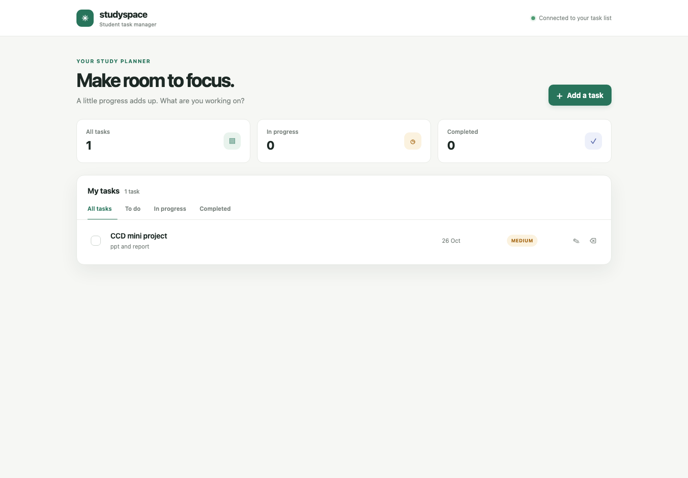
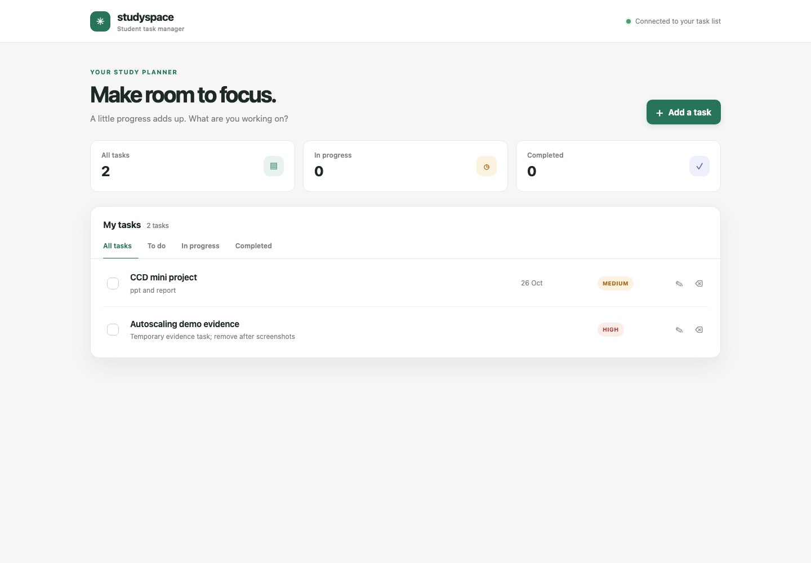
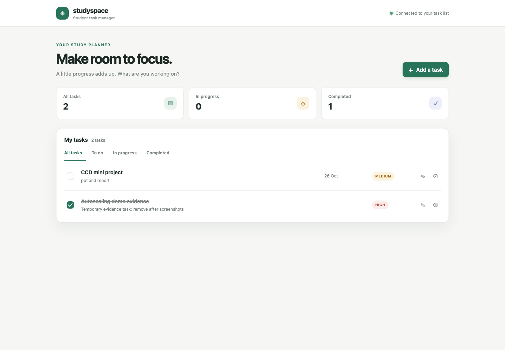

# Demo evidence record

**Recorded:** 2026-10-25
**Environment:** AWS Sydney (`ap-southeast-2`), single EC2 host running K3s, private RDS MySQL
**Workload:** Student Task Manager API, one baseline pod, HPA range 1–2, CPU target 60%

## Browser and API

- The deployed readiness endpoint returned `{"status":"UP"}` through an SSM port-forward.
- The deployed UI returned HTTP 200.
- The read-only load test used `GET /api/tasks`; it did not create, update, or delete tasks.
- [`student-task-manager-ui.png`](student-task-manager-ui.png) is a screenshot of the deployed UI through the temporary SSM tunnel.
- [`task-created.png`](task-created.png) and [`task-completed.png`](task-completed.png) show the UI before and after completion. The temporary evidence task was deleted afterward; the original task list was verified unchanged.







The UI showed one saved task, `CCD mini project`, with the API connection indicator green. The corresponding API request returned HTTP 200 and the saved task record. For the before/after screenshots, a temporary task (ID 3) was created, marked `DONE`, and then deleted with HTTP 204. A final API read showed only the original task (ID 2), so the demo left the user's existing task data unchanged.

## Autoscaling

The bounded k6 run used [`../load-tests/autoscaling.js`](../load-tests/autoscaling.js) with 30 maximum virtual users. It completed successfully:

| Measure | Observed result |
|---|---:|
| HTTP requests | 5,699 |
| Request rate | 43.7 requests/second |
| Failed requests | 0 / 0.00% |
| p95 response time | 403.98 ms |
| Maximum virtual users | 30 |

The HPA started at 1 replica. During load, CPU rose above the 60% target (observed at 248% and peaking at 319%), and HPA increased desired replicas to 2. Both API pods reached `1/1 Running`. After load stopped and the 180-second scale-down stabilization elapsed, HPA returned to 1 replica and the Deployment returned to `1/1 Ready`.

Representative observed Kubernetes output:

```text
HPA during load: cpu: 248%/60%   min 1   max 2   replicas 2
Deployment peak: READY 2/2   AVAILABLE 2
Pods at peak:    both 1/1 Running
HPA after load:  cpu: 3%/60%     min 1   max 2   replicas 1
Deployment final: READY 1/1   AVAILABLE 1
```

The GitHub Actions CI run for PR #2 also passed its application test/package/container build job and Terraform format/validation job: [run 33](https://github.com/myishaa/student-task-manager/actions/runs/40094738509). The PR was merged into `main`.

## Pod recovery

After refreshing the expired ECR pull secret, the failed replacement pod was removed and the Deployment created a new pod. The replacement reached `1/1 Running`; the Deployment remained `1/1 Available`. This demonstrates pod replacement by the Deployment controller.

Observed pod transition from the demo terminal:

```text
Deleted: task-manager-api-8457f74988-g8glg
Replacement: task-manager-api-8457f74988-8w6hl   1/1   Running
Deployment: task-manager-api                     1/1   Available
```

## Liveness probe

A separate controlled liveness test paused the Java process on the EC2 host. Kubernetes recorded `Container api failed liveness probe, will be restarted`; the container restart count increased to 1, and the API pod returned to `1/1 Running`. The readiness endpoint returned `{"status":"UP"}` afterward. CPU briefly rose to 88% and HPA added a second ready pod; after the metric settled, HPA returned to one replica at 3% CPU, the Deployment was `1/1 Available`, and readiness remained `UP`.

Relevant observed event:

```text
Liveness: http-get /actuator/health/liveness, period 10s, failure threshold 3
Normal Killing: Container api failed liveness probe, will be restarted
Restart Count: 1
Final readiness: {"status":"UP"}
```

## Live Prometheus and Grafana monitoring

The monitoring stack was deployed to the existing K3s host on 2026-10-25. No AWS infrastructure or public load balancer was added. Prometheus, Grafana, and kube-state-metrics run in `student-task-manager-monitoring`; their Services are `ClusterIP` only. Grafana was accessed through a temporary SSM port-forward to the private service.

| Component | Live result |
|---|---|
| Prometheus | `1/1 Running`, image `prom/prometheus:v3.14.0`, 35 MiB observed memory |
| Grafana | `1/1 Running`, image `grafana/grafana:12.4.13`, 0 restarts, 140 MiB observed memory |
| kube-state-metrics | `1/1 Running`, image `registry.k8s.io/kube-state-metrics/kube-state-metrics:v2.20.0`, 13 MiB observed memory |
| Prometheus targets | `prometheus`, `kube-state-metrics`, and `student-task-manager-api` all `up` |
| Grafana datasource | Health `OK`; API returned the provisioned “Student Task Manager - Operations” dashboard with six panels |
| Application | Readiness `UP`; Deployment `1/1`; HPA `1` replica at `4%/60%` CPU |
| EC2 node | `6%` CPU and `1347 MiB` memory used (`70%`) at the recorded check |

Live Prometheus queries at the time of capture returned:

```text
API request rate (5m):             0.3719 requests/second
5xx response rate (5m):            0
Mean API request duration (5m):    0.00893 seconds
Available API replicas:            1
HPA current replicas:               1
JVM heap used:                      49,917,728 bytes
Spring Boot process CPU:            0.0293 (about 2.9% of one core)
```

Prometheus scrapes every 15 seconds, retains up to six hours/256 MB in `emptyDir`, and does not persist history across pod replacement. Grafana's database is also temporary; the dashboard and datasource are provisioned from the Kubernetes manifests. The Grafana viewer is accessible only through the private ClusterIP and an authorized SSM session.

The dashboard itself is live and its datasource and panel configuration were verified. The monitoring-summary.svg graphic reconstructs selected recorded Prometheus values for presentation; it is explicitly not a Grafana screenshot. A PNG screenshot was not captured: Grafana's render endpoint reports that the Grafana Image Renderer plugin is not installed, and this session has no interactive display capture. The screenshot attempt was discarded rather than included as misleading evidence.

During initial startup, Grafana `13.2.4` exceeded its 192 MiB memory limit and was OOM-killed before becoming ready. It was replaced with `12.4.13` and a 384 MiB limit; the final pod reached `1/1 Running` with zero restarts and about 140 MiB observed memory. No application pod or task data was changed by this troubleshooting.

## Scope and limits

- The autoscaling and recovery evidence is for pods on one EC2 node. It does not demonstrate EC2 host failover.
- The pod deletion test demonstrates Deployment reconciliation; the separate liveness-probe restart is recorded above.
- The monitoring deployment and live query results are recorded above; the browser-access steps are in [`../DEMO_RUNBOOK.md`](../DEMO_RUNBOOK.md).
- Prometheus and Grafana use temporary storage in this demo, so monitoring history and Grafana's local database do not survive pod replacement.
- The HPA's maximum is two replicas for this cost-constrained demo, below the original plan's 2–4 target.
